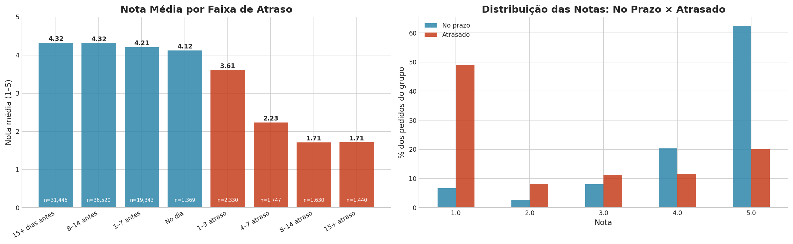
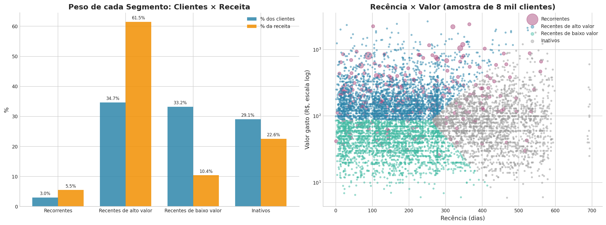
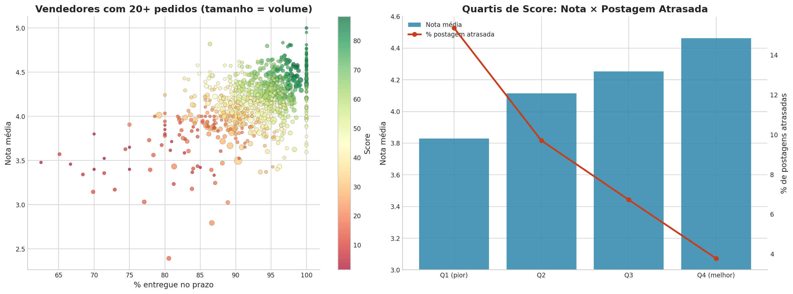

# Análise do E-commerce Brasileiro com Python
### Explorando 100 mil pedidos da Olist | 2016–2018

[](https://www.python.org/)
[](https://pandas.pydata.org/)
[](https://plotly.com/)
[](https://duckdb.org/)
[](https://streamlit.io/)
[](https://github.com/ViniciusBelo/olist-ecommerce-analysis/actions/workflows/testes.yml)

---

## Sobre o Projeto

Este projeto surgiu de uma curiosidade: **o que os dados de uma plataforma brasileira de e-commerce revelam sobre comportamento de compra, logística e satisfação dos clientes?**

A partir do dataset público da Olist (disponível no Kaggle), construí um pipeline completo de análise — da limpeza dos dados brutos até a segmentação de clientes com K-Means — usando Python como ferramenta principal.

O objetivo não é só responder perguntas analíticas, mas demonstrar um fluxo de trabalho organizado: código modularizado em `src/`, ETL reproduzível, visualizações padronizadas e análises com storytelling.

---

## Perguntas que Este Projeto Responde

- Quais clientes estão prestes a abandonar a plataforma?
- Quais categorias de produto geram mais receita — e mais satisfação?
- O atraso na entrega realmente derruba a avaliação do vendedor?
- Como segmentar a base de clientes para campanhas de retenção?

---

## Principais Insights

**O atraso na entrega derruba a nota — e o efeito é de limiar.** Pedidos entregues no prazo têm nota média 4,29; atrasados, 2,46. Chegar adiantado quase não muda a nota, mas a partir de 4 dias de atraso a média cai para perto de 2. Parte dessa queda, porém, é "o pedido ainda não chegou": dois terços dos clientes com pedido atrasado avaliaram antes de receber (nota média 1,84). Entre os que avaliaram depois de receber, a diferença para quem recebeu no prazo é de cerca de 0,6 ponto (3,69 × 4,29).



- **Receita:** R$ 13,2 milhões em pedidos entregues (sem frete). A receita cresceu ao longo de 2017 e se estabilizou entre R$ 0,8 e R$ 1 milhão por mês em 2018, com pico na Black Friday de novembro de 2017. Cartão de crédito responde por 76,6% dos pedidos.
- **Clientes:** 97% dos 93 mil clientes compraram uma única vez. SP, RJ e MG concentram dois terços dos pedidos, e os 20% clientes de maior valor somam 56,6% da receita.
- **Segmentação RFM:** um terço da base (*Recentes de alto valor*) gera 61,5% da receita — e é o grupo com a nota mais baixa (4,07). Os *Inativos* (29% dos clientes, última compra há mais de um ano em média) ainda somam 22,6% da receita histórica.
- **Entrega:** o prazo prometido é folgado (mediana de 23 dias contra 10 reais), e mesmo assim 7,6% dos pedidos atrasam. Os piores estados em pontualidade são AL (77%) e MA (81%); os piores meses, fevereiro e março de 2018.
- **Vendedores:** os 20% maiores vendedores fazem 82% da receita. Quando o vendedor posta o pacote fora do prazo, a chance de o cliente receber atrasado sobe de 6% para 23% — mas cerca de 73% dos atrasos acontecem mesmo com a postagem em dia.



---

## Dataset

| | |
|---|---|
| **Fonte** | [Brazilian E-Commerce Public Dataset by Olist — Kaggle](https://www.kaggle.com/datasets/olistbr/brazilian-ecommerce) |
| **Licença** | CC BY-NC-SA 4.0 |
| **Volume** | ~100k pedidos, 9 tabelas relacionais |
| **Período** | Set/2016 – Out/2018 (pedidos entregues até Ago/2018) |

---

## Estrutura do Projeto

```
olist-ecommerce-analysis/
├── data/
│   ├── raw/                    # CSVs originais do Kaggle (não versionados)
│   └── processed/              # Parquets limpos e enriquecidos (gerados pelos notebooks)
├── notebooks/
│   ├── 01_exploracao_inicial.ipynb
│   ├── 02_limpeza_e_enriquecimento.ipynb
│   ├── 03_analise_receita.ipynb
│   ├── 04_analise_clientes.ipynb
│   ├── 05_segmentacao_rfm.ipynb
│   ├── 06_analise_entregas.ipynb
│   └── 07_analise_vendedores.ipynb
├── src/
│   ├── config.py              # Paths e parâmetros centralizados
│   ├── data_loader.py         # Carregamento e validação dos dados
│   ├── data_cleaner.py        # Limpeza, tipagem e enriquecimento
│   └── visualizations.py      # Funções de visualização reutilizáveis
├── dashboard/
│   └── app.py                 # Dashboard Streamlit interativo
├── reports/
│   └── figures/               # Gráficos exportados
├── tests/
│   └── test_data_cleaner.py   # Testes unitários do ETL
├── .gitignore
├── requirements.txt
└── README.md
```

---

## Análises

### 1. Exploração Inicial (`01_exploracao_inicial.ipynb`)
Primeira passagem pelos dados: schema relacional dos 9 datasets, estatísticas descritivas, distribuição de nulos e outliers.

### 2. Limpeza & Enriquecimento (`02_limpeza_e_enriquecimento.ipynb`)
ETL completo — tipagem de datas, tratamento de nulos, feature engineering (dias de entrega, atraso, valor total) e merge de todas as tabelas numa fact table central.

### 3. Análise de Receita (`03_analise_receita.ipynb`)
Evolução mensal do GMV, top categorias, ticket médio por método de pagamento e sazonalidade semanal. Inclui consultas SQL (DuckDB) com `LAG`, `RANK` e `SUM OVER` para crescimento mês a mês, ranking de categorias por trimestre e concentração da receita.

### 4. Análise de Clientes (`04_analise_clientes.ipynb`)
Mapa de pedidos por estado, padrão de compra por hora/dia, taxa de recompra, LTV básico e novos clientes por mês.

### 5. Segmentação RFM com K-Means (`05_segmentacao_rfm.ipynb`)
Cálculo de Recência, Frequência e Valor Monetário por cliente. K escolhido com método do cotovelo e coeficiente de silhueta (k=4), resultando nos segmentos: Recorrentes, Recentes de alto valor, Recentes de baixo valor e Inativos — com uma ação sugerida para cada um.

### 6. Análise de Entregas (`06_analise_entregas.ipynb`)
Prazo real × prometido, pontualidade por estado e por mês, e o efeito do atraso na nota (teste de Mann-Whitney e análise por faixas de atraso).

### 7. Performance de Vendedores (`07_analise_vendedores.ipynb`)
Concentração de receita, impacto da postagem atrasada pelo vendedor, score composto (avaliação + pontualidade + volume) e vendedores que pararam de vender.



### Dashboard (`dashboard/app.py`)
Quatro abas — visão geral, clientes (RFM), entregas e vendedores — com filtros de período e estado.

---

## Como Executar

**1. Clone o repositório**
```bash
git clone https://github.com/ViniciusBelo/olist-ecommerce-analysis.git
cd olist-ecommerce-analysis
```

**2. Crie o ambiente virtual e instale as dependências**
```bash
python -m venv .venv

# Windows
.venv\Scripts\activate

# Linux/Mac
source .venv/bin/activate

pip install -r requirements.txt
```

**3. Baixe os dados**
Acesse o [dataset no Kaggle](https://www.kaggle.com/datasets/olistbr/brazilian-ecommerce), baixe e extraia os CSVs para `data/raw/`.

**4. Execute os notebooks na ordem numérica**
```bash
jupyter lab
```
O notebook 02 gera o `orders_enriched.parquet`, usado por todos os seguintes. Os notebooks 05, 06 e 07 geram os arquivos usados pelo dashboard.

**5. Rode o dashboard**
```bash
streamlit run dashboard/app.py
```

**6. Rode os testes**
```bash
pytest tests
```

---

## Tech Stack

| Ferramenta | Papel no Projeto |
|---|---|
| Python 3.11 | Linguagem principal |
| Pandas 2.2 / NumPy | Manipulação e transformação dos dados |
| Plotly / Seaborn / Matplotlib | Visualizações interativas e estáticas |
| DuckDB | Consultas SQL com window functions sobre os DataFrames |
| Scikit-learn | K-Means para segmentação RFM |
| SciPy | Testes estatísticos (Mann-Whitney, Spearman) |
| Streamlit | Dashboard interativo |
| Pytest + GitHub Actions | Testes automáticos do ETL |
| Jupyter Lab | Análise exploratória |

---

## Roadmap

- [x] Estrutura do projeto e configuração
- [x] Módulos `src/` (loader, cleaner, visualizations)
- [x] Notebook 01 — Exploração inicial
- [x] Notebook 02 — Limpeza e ETL
- [x] Notebook 03 — Análise de receita
- [x] Notebook 04 — Análise de clientes
- [x] Notebook 05 — Segmentação RFM
- [x] Notebook 06 — Análise de entregas
- [x] Notebook 07 — Performance de vendedores
- [x] Dashboard Streamlit
- [x] Testes unitários

---

*Projeto de portfólio — Análise de Dados com Python*
